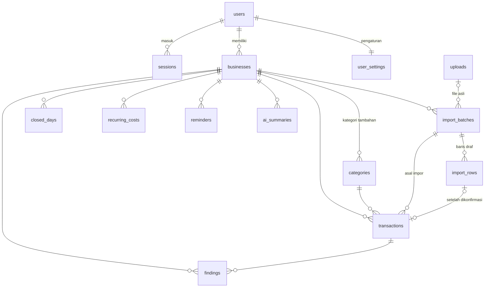

# Rancangan Database NAIK.IN

PostgreSQL, database `naikin`. Skema dibangun oleh migrasi berurutan di `backend/db/migrations/`:

| Migrasi | Isi |
|---|---|
| `001_naik_in.sql` | `users`, `sessions`, `businesses`, `uploads`, `analyses`, `reports`, `ai_cache` |
| `002_keuangan.sql` | Kategori, transaksi, impor "Periksa dulu", temuan "Perlu Dicek", hari libur, pengaturan, ringkasan AI, view rekap |
| `003_simulasi_kur.sql` | `categories.tetap` (biaya tetap), minggu valid jadi ≥ 5 hari, pengaturan KUR di `user_settings`, tabel `loan_simulations` |
| `004_label_produk.sql` | `products`, `label_checks` (isian 9 keterangan wajib + skor saat dikonfirmasi), view `v_label_terakhir` |

Jalankan dari folder `backend`: `npm run db:migrate` lalu `npm run db:seed`.

## Diagram relasi

## Aturan yang dijaga database

1. **Tidak ada transaksi tanpa konfirmasi.** Kolom `transactions.dikonfirmasi_at` wajib diisi (`NOT NULL`). Hasil impor, scan, atau AI disimpan dulu di `import_rows`. Baris itu baru disalin ke `transactions` setelah pengguna menekan "Konfirmasi dan simpan".
2. **Nominal selalu positif.** `nominal bigint > 0`, dalam rupiah bulat. Arah uang ditentukan kolom `arah` (`masuk`/`keluar`), bukan tanda minus.
3. **Arah transaksi harus sama dengan arah kategorinya.** Ini dijaga trigger `transactions_cek_arah`. Contohnya, uang keluar tidak bisa diberi kategori Penjualan.
4. **Kelompok kategori menentukan cara hitung.** Kolom `categories.kelompok` hanya boleh salah satu dari `penjualan`, `pemasukan_lain`, `hpp`, `operasional`, `pribadi`. Constraint memastikan kelompok selalu cocok dengan arahnya.
5. **Hapus lunak.** `transactions.dihapus_at` diisi saat transaksi dihapus, sehingga rekap lama masih bisa diaudit. Semua view hanya membaca baris yang `dihapus_at IS NULL`.

## Tabel

### `categories`
Ada dua jenis kategori. **Kategori bawaan** punya `business_id` NULL dan diisi oleh migrasi. **Kategori tambahan** dibuat pengguna dan menempel ke usahanya. Kolom `kode` adalah slug yang stabil (`bahan-baku`, `pribadi`, …) dan sama dengan id kategori di frontend.

| Kelompok | Masuk ke perhitungan |
|---|---|
| `penjualan` | Omzet, Uang Masuk, Laba Usaha (+) |
| `pemasukan_lain` | Uang Masuk saja (contoh: transfer dari keluarga, pinjaman) |
| `hpp` | HPP, Uang Keluar, Laba Usaha (−) |
| `operasional` | Biaya Operasional, Uang Keluar, Laba Usaha (−) |
| `pribadi` | Pengeluaran Pribadi, Uang Keluar. Tidak mengurangi laba usaha |

### `transactions`
Riwayat transaksi yang sudah dikonfirmasi. Kolom `sumber` mencatat asal data: `contoh`, `manual`, `unggah_file`, atau `scan_foto`. Kolom `import_batch_id` menunjuk ke batch impor asalnya.

### `import_batches` & `import_rows` — layar "Periksa dulu"
- Satu kali scan atau unggah file menghasilkan satu `import_batches` dengan `status = 'draf'`.
- Setiap baris hasil baca disimpan di `import_rows`, lengkap dengan `data_mentah`, `tanggal_asli` (teks asli dari file), dan `masalah`. Kolom `masalah` berisi daftar `{tingkat: 'galat'|'peringatan', pesan}` dari validasi: tanggal tidak terbaca, tanggal di masa depan, duplikat, atau di luar rentang file.
- Saat dikonfirmasi, baris yang `disertakan` disalin ke `transactions`, `import_rows.transaction_id` diisi, lalu status batch menjadi `dikonfirmasi`. Constraint menjamin `dikonfirmasi_at` hanya terisi kalau statusnya memang `dikonfirmasi`.

### `findings` — tab "Perlu Dicek"
Kolom `jenis` berisi salah satu dari: `kemungkinan_pribadi`, `pemasukan_bukan_penjualan`, `duplikat`, `nominal_tidak_biasa`, `tanggal_bermasalah`, `hari_belum_dicatat`.
- Kolom `kunci` adalah id yang stabil, misalnya `duplikat:<id transaksi>` atau `hari_belum_dicatat:2026-10-29`. Dengan kunci ini, temuan yang sudah ditindak tidak muncul lagi saat deteksi dijalankan ulang (`UNIQUE (business_id, kunci)`).
- Untuk temuan `hari_belum_dicatat`, kolom `rentang_dari` dan `rentang_sampai` wajib diisi. Untuk jenis lain, `transaction_id` yang wajib diisi.
- `status`: `terbuka` → `ditindak`/`diabaikan`. Kolom `tindakan` mencatat tombol yang dipilih, misalnya `jadikan_pribadi`, `hapus_duplikat`, atau `tandai_libur`.
- Kolom `alasan` adalah teks "alasan deteksi AI" yang ditampilkan di panel detail transaksi.

### `closed_days`
Hari yang ditandai tutup atau libur. Hari ini dihitung sebagai hari tercatat saat menilai kelengkapan minggu.

### `recurring_costs`, `reminders`, `user_settings`
- `recurring_costs`: biaya rutin usaha dan kebutuhan rumah tangga per bulan. Data ini dipakai nanti oleh Simulasi Kesiapan KUR.
- `reminders`: pengingat catat harian (dengan jam) dan ringkasan mingguan.
- `user_settings`: saklar Pengaturan Demo (`demo_akun_kosong`, `demo_data_tiga_bulan`, `mode_offline`) dan status `tur_selesai`. "Akun kosong" dan "data 3 bulan" tidak bisa aktif bersamaan.

### `ai_summaries`
Ringkasan analisis keuangan. Kolom `angka` menyimpan angka hasil hitungan sistem yang dikirim ke AI. Kolom `poin` berisi 4–5 poin yang ditampilkan. Kolom `sumber` bernilai `ai` atau `templat`. Kolom `jumlah_transaksi` dipakai untuk stempel "dari N transaksi terkonfirmasi".

### `businesses` (kolom tambahan)
`kategori_usaha`, `mulai_usaha`, `metode_pembayaran[]`, `rekening_terpisah`, `punya_catatan`, dan `onboarding_selesai_at` diisi lewat onboarding 3 langkah. Lama usaha dihitung dari `mulai_usaha`. Kolom lama `usia_usaha_bln` sudah tidak dipakai.

### `loan_simulations` — Simulasi Kesiapan KUR
Tabel ini menyimpan simulasi yang dipilih lewat tombol "Simpan simulasi" atau "Masukkan ke Laporan". Perhitungannya sendiri berjalan di frontend (`frontend/src/lib/engine/loan`, tanpa jaringan). Database menyimpan angka input (laba rata, laba stress, uang dapur, cicilan lama) dan angka hasil (cicilan, batas aman, sisa kas, status, cadangan, risiko NPL, seed simulasi), sehingga setiap simulasi bisa diaudit ulang. Constraint-nya:
- Plafon harus Rp5–50 juta dalam kelipatan Rp500 ribu, dan tenor hanya boleh 12, 24, atau 36 bulan.
- Simulasi berstatus `kuning` wajib menyertakan target cadangan.
- Per usaha, hanya satu simulasi yang boleh `di_laporan`.

### `products` & `label_checks` — Label Produk
Setiap kali pengguna menekan "Konfirmasi & hitung skor", satu baris baru masuk ke `label_checks`. Baris itu menyimpan isian 9 keterangan wajib (nilai, lokasi di kemasan, tidak berlaku), teks klaim, serta skor dan rincian dari engine (`frontend/src/lib/engine/label`). Riwayat pemeriksaan tetap tersimpan. View `v_label_terakhir` mengambil pemeriksaan terbaru per produk, dan view itu yang dipakai untuk chip "Skor Label" dan Laporan. Isian hasil baca AI baru ikut disimpan setelah dikonfirmasi (`sumber_isian = 'ai_dikonfirmasi'`).

Kolom `categories.tetap` menandai biaya operasional tetap (bawaan: Sewa tempat). Biaya tetap ini dirata-rata per minggu saat menghitung Laba_minggu.

## View

| View | Isi |
|---|---|
| `v_transaksi` | Transaksi aktif beserta `kategori_kode`, `kategori_nama`, dan `kelompok` |
| `v_rekap_mingguan` | Per minggu Senin–Minggu: uang masuk, penjualan, HPP, operasional, pribadi, uang keluar, laba usaha, selisih kas, hari tercatat |
| `v_rekap_bulanan` | Kolom yang sama, dikelompokkan per bulan |
| `v_kelengkapan_mingguan` | Hari tercatat per minggu (transaksi + hari libur). `lengkap` bernilai true bila minimal 5 dari 7 hari tercatat (sejak migrasi 003) |

Rumusnya sama persis dengan `frontend/src/lib/finance.ts`:
- **Laba usaha** = penjualan − HPP − operasional
- **Selisih kas** = semua uang masuk − semua uang keluar

## Data contoh

`npm run db:seed` membuat akun demo `demo@naik.in` / `demo123456` (Ibu Sari Wulandari) dengan usaha "Keripik Balado Bu Sari" di Padang, yang sudah berjalan 26 bulan. Seed juga memasukkan 692 transaksi (4 Mei – 7 Nov 2026), dan menghapus data contoh lama (Keripik Singkong Bu Sari, Rendang Kemasan Uni Dewi).

Transaksinya diambil dari `backend/db/seed-data/bu-sari.json`. File ini dihasilkan dari generator frontend dengan perintah `npm run export:demo` di folder `frontend`, jadi aplikasi dan database selalu memakai data yang sama. Kalau view database dicek, hasilnya cocok dengan spesifikasi:

- Rekap bulanan Mei–Okt sama dengan tabel spesifikasi.
- 24 dari 26 minggu lengkap (92%).
- Laba mingguan: rata-rata Rp1.375.000, kuartil bawah Rp712.500, terendah Rp480.000.

## API data aplikasi

Setelah pengguna masuk, frontend memuat semua data lewat `GET /api/data`. Setiap perubahan dikirim ke endpoint di bawah lewat antrean berurutan (`frontend/src/state/sinkron.ts`). Semua endpoint memakai cookie sesi `naik_session`, hanya bisa mengakses usaha milik pengguna itu sendiri, dan menjalankan setiap permintaan dalam satu transaksi database (`backend/lib/server/rute.ts`).

| Endpoint | Tabel |
|---|---|
| `GET /api/data` | semua tabel (profil, kategori, transaksi, temuan, libur, pengaturan, simulasi, produk + cek label terakhir, ringkasan AI) |
| `POST /api/transactions` | `import_batches` + `transactions` (hanya baris yang sudah dikonfirmasi) |
| `PATCH` / `DELETE /api/transactions/:id` | `transactions` (ubah; hapus lunak) |
| `POST /api/findings` | `findings` (+ `closed_days` untuk "tandai libur") |
| `PUT /api/profile` | `users`, `businesses` (membuat usaha saat onboarding) |
| `PUT /api/settings` | `user_settings`, `reminders`, `recurring_costs` |
| `POST /api/categories`, `DELETE /api/categories?kode=` | `categories` |
| `POST /api/loan-simulations`, `PATCH`/`DELETE /api/loan-simulations/:id` | `loan_simulations` |
| `PUT` / `DELETE /api/products/:id` | `products` (+ `label_checks` bila menyertakan `pemeriksaan`) |
| `POST /api/ai-summaries` | `ai_summaries` |
| `POST /api/data/hapus-semua` | menghapus lunak transaksi; menghapus temuan, hari libur, dan ringkasan AI |

ID baru dibuat di browser dalam format UUID (`crypto.randomUUID()`), jadi ID di tampilan sama dengan ID di database. Laporan tidak punya tabel sendiri karena disusun dari data di atas. Kalau backend tidak bisa dihubungi, aplikasi berjalan dalam **mode lokal** dengan data contoh di browser, dan ada label "Mode lokal" di bagian atas halaman.
